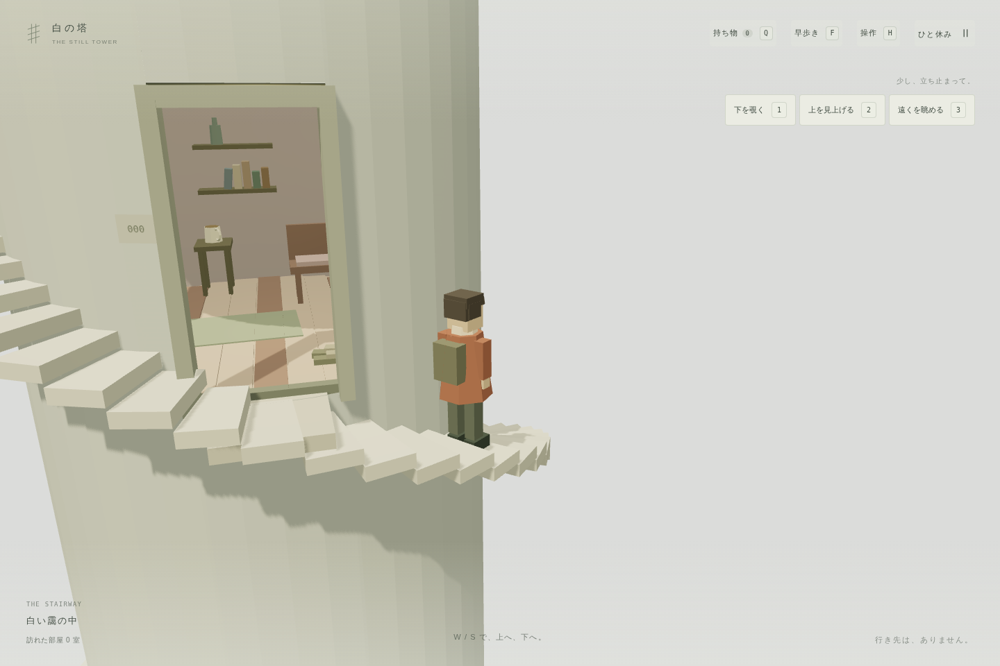
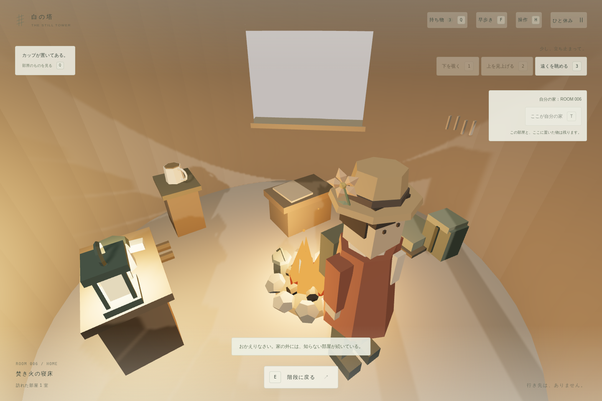
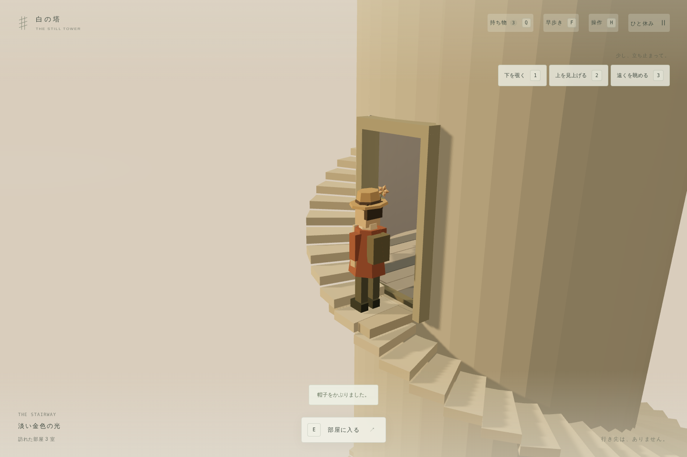
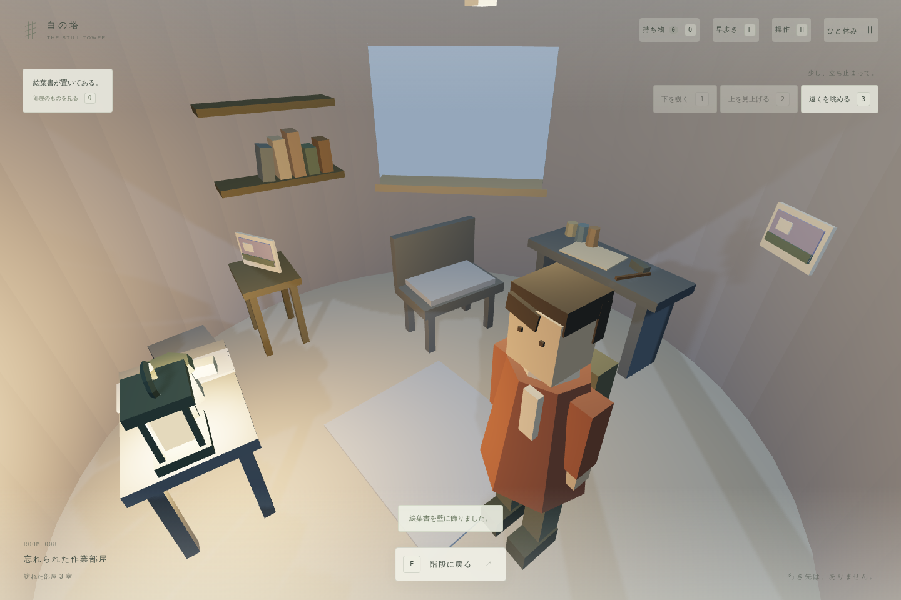
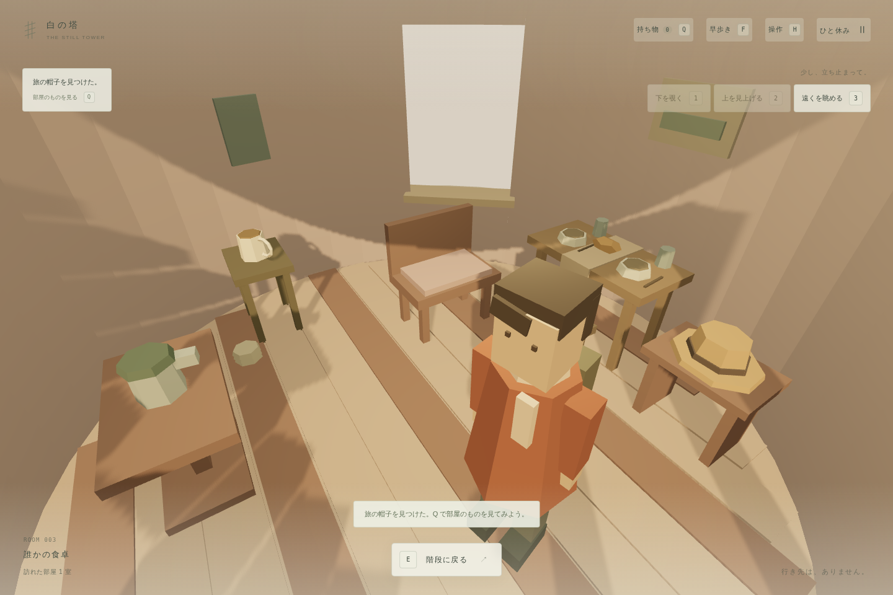
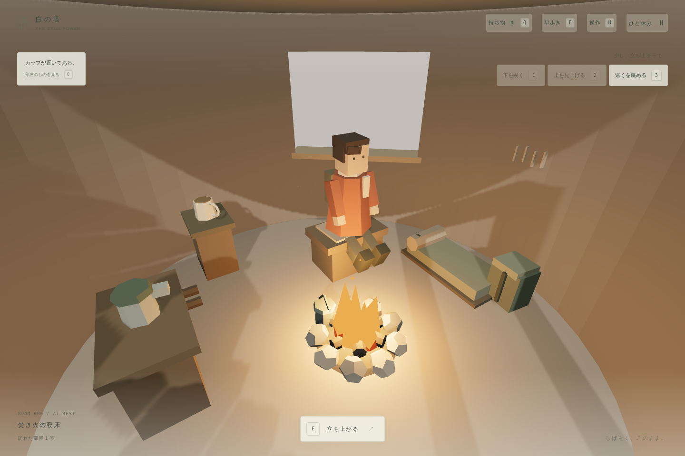
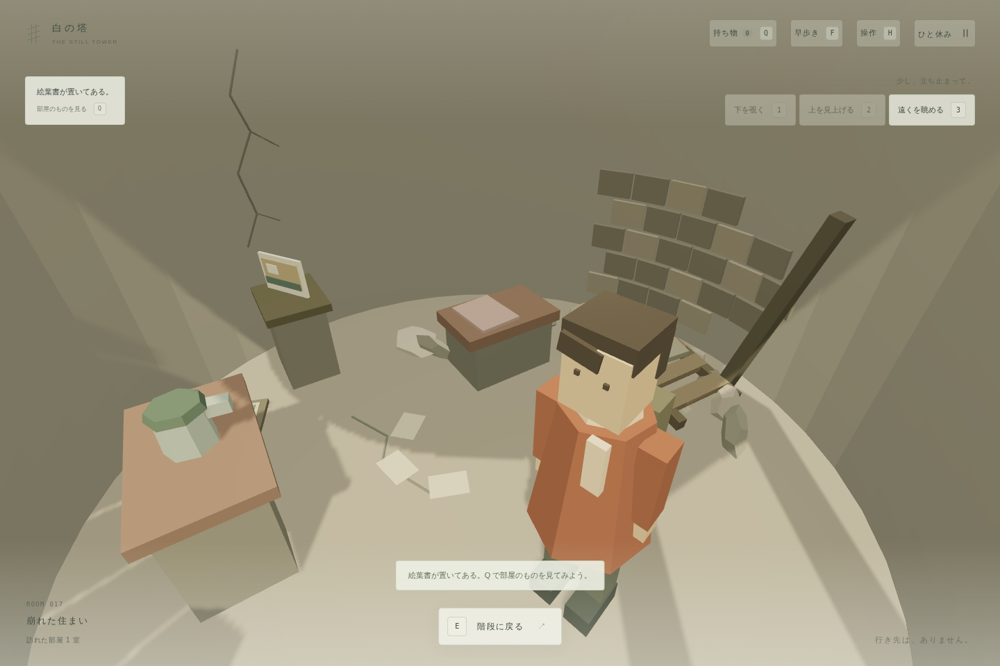

# 白の塔 — The Still Tower

白い靄の中に続く螺旋階段を、上ったり下ったりするブラウザ用の3D散策ゲームです。無音・ローポリ・自動追従カメラで、部屋を訪ねたり、拾った品を飾ったりして過ごせます。

スクリーンショットは開発途中のもので、現在の表示と一部異なります。WebGL 2に対応したブラウザが必要です。



## 起動

Node.js 24以降を使用します。プロジェクトのフォルダーで実行してください。

```bash
npm ci
npm run dev
```

表示されたローカルURLをブラウザで開きます。通常は `http://localhost:5173/` です。依存パッケージをインストール済みなら、次回からは `npm run dev` だけで起動できます。

## 操作

| 操作 | キー |
|---|---|
| 階段を上る・下る | W / S または ↑ / ↓ |
| 室内を歩く | WASD または矢印キー |
| 部屋に入る・外に出る | 入口付近で E、または画面の操作ボタン |
| 座る・立ち上がる | 椅子付近で E |
| 部屋のもの・持ち物をひらく／閉じる | Q、または画面上の「持ち物」 |
| 持ち物画面で選ぶ・決定する | W / S（A / D、矢印キーも可）で選択、E で決定。各ボタンのクリックも可 |
| 拾う・置く・灯す・お茶・装飾品の着脱 | 持ち物画面で各操作を選ぶ |
| 絵葉書を読む・閉じる | 持ち物の「読む」、閉じるときは Esc |
| 早歩きの切り替え | F、または画面上の「早歩き」 |
| 下を覗く・上を見上げる・遠くを眺める | 1 / 2 / 3、または画面の各ボタン |
| いつもの視点に戻る | 同じボタン、Esc、または移動キー |
| 今いる部屋を自分の家にする | 室内で T、または画面の「ここを自分の家にする」 |
| 飛び降りて家に帰る | 家を決めたあと、階段で R、または画面の「飛び降りて家に戻る」 |
| 一時停止・再開 | Esc |
| 操作ガイド | H |

- 階段では経路に沿って移動します。通常の歩行では落ちず、R または専用ボタンで飛び降ります。
- カメラは自動で追従します。マウス操作は不要です。
- 持ち物画面を開いている間、移動キーは項目選択に使います。Q・W/S・Eだけで収集や着替えができます。
- 眺めている間は立ち止まります。下・上を見る操作は階段で、遠くを眺める操作は室内や着席中も使えます。
- 「ひと休み」から歩く速さと描画品質を変更できます。早歩きは階段で「ふつう」の約2倍、室内では少し控えめです。
- 左下に、現在の塔で訪れた部屋の数を表示します。再訪では増えず、飛び降りた後は家の1室から数え直します。
- 位置、着席状態、設定、訪問記録、持ち物、部屋に置いた品、ランタンの点灯状態、装飾品の取得・着用状態、自分の家と現在の塔を同じブラウザに自動保存します。保存を利用できない環境でも、その散策中は記録を保ちます。
- 以前のセーブも読み込めます。入口の間隔を2周から1周に短縮したため、部屋番号と訪問記録を引き継ぎ、階段上の位置は新しい間隔に合わせて移します。
- 別のタブやアプリへ移ると一時停止します。
- タッチ端末には移動ボタンが表示されます。主な検証対象はPCのChromiumです。

## 塔の生成と保存

初回にランダムなシードで塔を生成し、このブラウザに保存します。再訪や再読み込みでは同じ部屋を再現し、飛び降りるたびに家以外を新しいシードで生成します。保存できない環境では、ページを閉じると記録が失われます。

## 自分の家と帰宅

気に入った部屋に入り、T で自分の家にできます。家は1つだけで、別の部屋で指定すると変更されます。家を決めると、階段から R で飛び降りられます。

約5秒間、塔の脇を落下すると画面が白くなり、家の中に戻ります。そのたびに家以外の部屋が入れ替わり、前の塔の部屋には戻れません。

| 対象 | 帰宅した後 |
|---|---|
| 自分の家 | 内装・窓・家具・未取得の品をそのまま保持 |
| 家に置いた品 | 配置とランタンの点灯状態を保持 |
| 持ち歩いている品・取得した帽子や花 | すべて引き継ぎ、着用状態も保持 |
| 家以外の部屋 | 新しい内容で生成。そこに置いてきた品は失われる |
| 訪問数 | 家の1室から数え直す |

- 家を変更しても、その時点では部屋は変わりません。次に飛び降りると、新しい家だけが引き継がれます。
- 新しい塔の同じ番号の部屋でも、別の品を拾えます。以前の塔から持ち越した品の種類・色・手紙は変わりません。
- 落下中も Esc で一時停止できます。途中で再読み込みした場合は、同じ帰宅を1回だけ完了して家から再開します。




## NPC・商人と家の拡張

- ときどき旅人や商人が部屋にいます。Q で会話や売買ができます。商人は余った品をコインで買い取ります。一括売却では持ち物の各種類を1つ残し、装飾品は同じ色のダブりだけを売ります。
- 商人から拡張キットを購入し、自分の家で Q から設置できます。飾り棚は2段階（各種類を最大3個展示）、ロフトは休憩とお茶、継ぎ足しベランダは外を歩ける足場です。ロフト・ベランダへは Q から移動し、E で室内に戻れます。

- コイン、未設置のキット、設置した拡張は飛び降りた後も引き継ぎます。家を変更すると拡張も移り、以前の家の棚からあふれる品は持ち物に戻ります。

## 部屋で過ごす

各部屋の小さな台には、カップ・ランタン・絵葉書のいずれかが置かれています。「持ち物」から拾い、別の部屋へ持っていけます。拾ったものは元の部屋に再出現しません。

| 持ち物 | できること |
|---|---|
| カップ | 持っているか部屋の机に置いてあると、お茶を淹れて椅子で休める。湯気と飲むしぐさを眺められる |
| ランタン | 机に置き、灯りをつけたり消したりできる。暖かな光が部屋を照らす |
| 絵葉書 | 短い手紙を読む、部屋の壁に飾る。見つけた部屋によって6種類の便りがある |
| 旅の帽子 | ときどき部屋で見つかる。拾ってかぶる、はずす、別の帽子に替える |
| 小さな花 | ときどき部屋で見つかる。拾って髪に飾る。帽子と一緒につけられる |

- カップ・ランタン・絵葉書は、通常は各部屋に種類ごとに1つずつ置けます。家の飾り棚を増設すると各種類を最大3個飾れます。置いた品は持ち物に戻して移せます。
- 帽子と花は部屋ごとに色が異なり、それぞれ1つずつ着用できます。取得後は元の部屋に再出現しません。
- 同じ塔では、遠くまで歩いてから戻っても、置いた品と灯りの状態が残ります。
- お茶を飲み終えるには持ち物画面の「飲み終える」、立ち上がるには E を使います。
- 絵葉書を読んでいる間は移動が止まります。閉じると散策に戻ります。





## 部屋の違いと窓

| 部屋 | 主な特徴 |
|---|---|
| 暮らしの名残 | 寝具、毛布、鉢植え、木の床 |
| 静かな空室 | 少ない家具、たたまれた布や置き去りの箱 |
| 風化した部屋 | 欠片、枯れた草、床のひび |
| 小さな書斎 | 本棚と色の異なる本、敷物 |
| 植物のいる部屋 | 高さや配置が異なる鉢植え、じょうろ |
| 忘れられた作業部屋 | 作業台、紙、道具、小瓶 |
| 崩れた住まい | 露出した石積み、壁や床のひび、崩れた寝台、瓦礫、落ちた額 |
| 焚き火の寝床 | 石で囲んだ火、やかん、寝袋、荷物、積んだ薪。熾火だけが残る部屋もある |
| 誰かの食卓 | 二人分の器、ずれた腰掛け、食べ物、干した布 |
| 縫いかけの部屋 | 織りかけの布、糸巻き、作業台、洗濯物、布の入った籠 |

- 内装は4系統の色、家具の形や小物の有無・数を組み合わせて生成します。飛び降りるまでは、同じ部屋を再訪しても内装は変わりません。自分の家は飛び降りた後も同じ内装です。
- 焚き火の炎・火の粉・暖かな灯りが静かに揺れます。そばに座って休んだり、カップがあればお茶を飲んだりできます。火と家具は歩いて避けられ、一時停止中は炎も止まります。
- 廃墟や焚き火の部屋では、腰掛けや物を置く台も石・木箱に変わります。残された日用品で暮らしの跡を表現しています。
- 一部の部屋には横長または縦長の窓があります。外壁・内壁の両方に開口があり、外の霧、空、雲が実際に見えます。
- 室内で 3 を押すと、窓の有無にかかわらず入口の外を眺めます。
- 塔を一周する帯を取り除き、部屋の高さで外壁の面がずれない形にしています。







## 塔の外の変化

高さに沿って、白い靄・淡い金色の光・青い薄暮・雲の通り道へと、霧や空の色、光の向きと強さが滑らかに変わります。4部屋ごとに次の景色へ移り、16部屋で一巡します。降りれば同じ高さで同じ色に戻れます。雲はゆっくり周囲を流れます。

## プロトタイプの範囲

- 上下に区間を生成する塔と、幅約84cmの外階段。
- 螺旋階段1周・45段・約7.65mごとの入口。10種類の内装、色や小物の変化、ときどき現れる窓。
- 入室、室内の移動、着席、退室。
- 本棚、額、タオル、スリッパ、食器、毛布、鉢植えなど、部屋の種類に応じた生活の小物。
- 早歩き、3種類の眺める視点、重複しない訪問数とその保存。
- 持ち物の収集と配置、お茶、ランタン、絵葉書、帽子と花の着脱。
- 家の指定と変更、約5秒の落下とホワイトアウト、家を残した塔の入れ替え。
- 高さに応じた空と距離霧、流れる雲、簡単な影、ローポリの人物と歩行アニメーション。
- 周囲11区間の保持と描画座標の原点移動。区間番号に対応した部屋を再現し、遠い部屋の家具は描画を省略。

音、戦闘、目標やスコアはありません。人物・家具はコードで生成した仮のモデルです。階段では滑らかな経路上を移動するため、足と各段の厳密な接地は省略しています。

## ビルド

```bash
npm run build
npm run preview
```

`dist/` に生成されたファイルを静的ホスティングで配信できます。専用のバックエンドは不要です。公開先がサブディレクトリの場合は、そのパスをビルド時に指定します。

```bash
npm run build -- --base=/game-spiral-staircase-tower/
```

TypeScript、Vite、Three.jsを使用し、人物・家具・塔はコードで生成しています。


主な動作確認対象は Chromium です。Safari / Firefox と実機でのフレームレートは未検証です。開発用テストはリポジトリに含めていません。

## 構成

| ファイル | 役割 |
|---|---|
| `src/model.ts` | 寸法、螺旋の座標、塔と家の生成情報、品の識別、保存データの検証 |
| `src/atmosphere.ts` | 高さによる霧・空・照明の変化、雲の描画 |
| `src/world.ts` | 塔、階段、入口、部屋と家具、区間の生成と解放 |
| `src/room-stories.ts` | 廃墟・焚き火・食卓・裁縫の内装、炎と火の粉の動き |
| `src/architecture.ts` | 継ぎ目の揃った外壁、内壁、実際に開いた窓 |
| `src/accessories.ts` | 部屋と主人公で共有する帽子・花のモデル |
| `src/character.ts` | 人物のモデルと歩行・着席・落下ポーズ |
| `src/return.ts` | 落下の軌跡、ホワイトアウトと帰宅のタイミング |
| `src/game.ts` | 移動、カメラ、描画、入退室、家の指定と帰宅、保存 |
| `src/main.ts` / `src/style.css` | 開始画面、操作、設定、タッチ用ボタン |
| `src/trade.ts` | コイン、売買、拡張キットの購入と設置 |
| `src/room-life.ts` | NPCと飾り棚・ロフト・ベランダのモデル |

設計の背景は [技術選定メモ](docs/feasibility.md)を参照してください。
